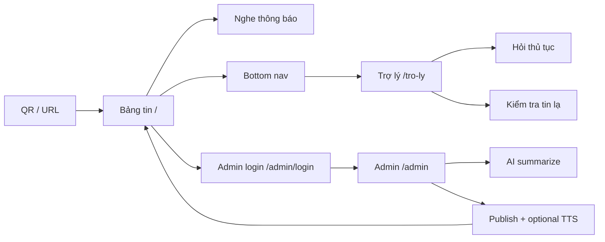
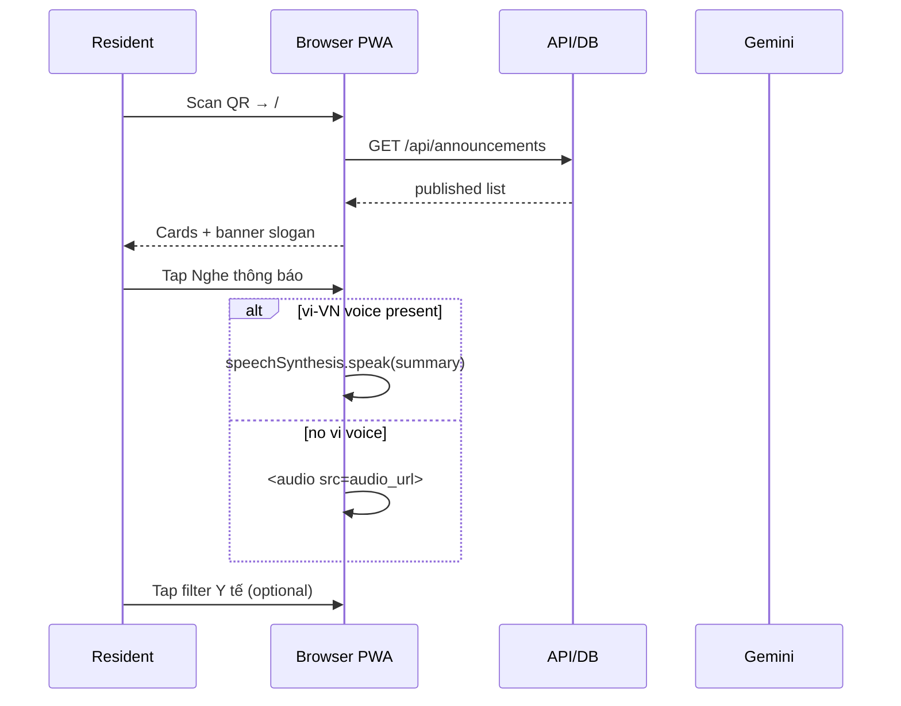
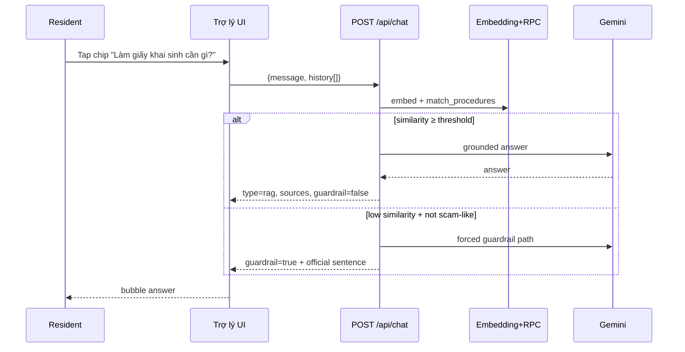
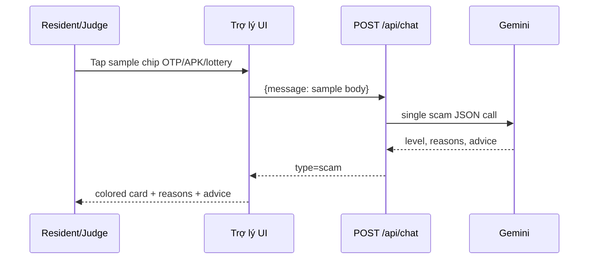
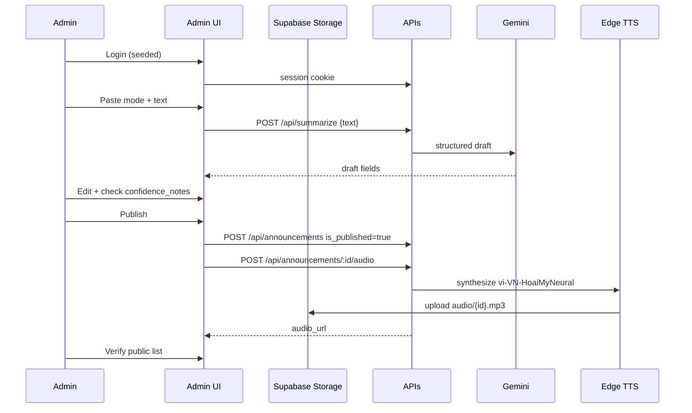

# 03 · User Flows & Journeys

**Product:** Tổ Mình Ơi  
**Document status:** Locked (v1)

---

## Flow map (top level)



---

## F1 · Resident opens app and hears a notice (primary demo path)



**Happy AC:** list visible <2 s; speech/MP3 starts on tap; no login.

**Failure branches:**

| Branch | UI |
|--------|-----|
| Offline | VI network error banner, retry |
| No voice + no MP3 | Hide/disable listen; text remains |
| 429 on other APIs | Not on this path (list is DB-only) |

---

## F2 · Resident asks procedure question



**Branches:**

| Case | Result |
|------|--------|
| In corpus | Structured answer + sources |
| Out of corpus | Fixed One-door sentence |
| Gemini 429 after retry | Friendly “đông, thử lại sau” |
| Mic unsupported | No mic button |

---

## F3 · Resident checks scam message (sample one-touch)



**Expected demo:** samples → 🔴 danger with ≥2 reasons.

**Branches:**

| Case | Result |
|------|--------|
| Model returns caution | 🟡 card still valid UX |
| Mixed rag+scam paste | Heuristics prefer scam if paste-like |
| Empty message | 400 `bad_request` |

---

## F4 · Resident free-form scam paste

Same as F3 with typed/pasted content (≤2000 chars).  
Optional mic → fill input → Send.

---

## F5 · Admin: text → publish → listen on iOS



**Failure:** Edge TTS fail → publish kept, warning banner.

---

## F6 · Admin: photo → publish

1. Login → New notice → paste text and/or choose photo (single combined input).  
2. Client validates size/type → `storage.upload` → public URL.  
3. `POST /api/summarize {text?, imageUrl?}` → draft (Gemini vision OCR).  
4. Unreadable → VI error “thử ảnh rõ hơn hoặc dán văn bản”.  
5. Continue as F5 from edit step.

---

## F7 · Admin edit / hide / delete

```text
/admin list
  ├─ Edit → PATCH fields → save → public reflects
  ├─ Ẩn → PATCH is_published=false → gone from /
  ├─ Hiện → PATCH is_published=true
  └─ Xóa → DELETE → confirm dialog → gone everywhere
```

No session → redirect `/admin/login`.

---

## F8 · Font scale journey

```text
Home → FontSizeToggle → Lớn → all text scales
→ reload → still Lớn (localStorage)
```

---

## F9 · Guardrail journey (negative path)

```text
User: "Chính sách ưu đãi đất nông thôn năm 2030 cho hộ mới?"
→ embed low sim, not scam-like
→ guardrail sentence to Bộ phận Một cửa
→ chips still available for next try
```

---

## Journey summary table

| ID | Actor | Entry | Exit success | Key failures |
|----|-------|-------|--------------|--------------|
| F1 | P | QR | Hears notice | No audio path |
| F2 | P | Chat chip | Grounded answer | Guardrail / 429 |
| F3 | Judge | Sample chip | 🔴 card | level≠danger |
| F4 | P | Paste/mic | Card or RAG answer | bad_request |
| F5 | A | Login | Published + audio | TTS fail |
| F6 | A | Photo | Draft published | OCR fail |
| F7 | A | List | Updated visibility | 401 |
| F8 | P | Toggle | Bigger text | — |
| F9 | P | Odd question | Official refusal | — |

---

## Demo script (90 s) alignment

| Time | Flow |
|------|------|
| 0–10 s | F1 open + filter + hear |
| 10–40 s | F2 ask procedure + source |
| 40–70 s | F3 sample scam → red card |
| 70–90 s | F5/F6 admin speed-run (optional cut) |

---

## Related documents

- Acceptance → `02-USER-STORIES.md`
- Screens → `04-UI-UX-SPEC.md`
- API → `08-API-SPEC.md`
