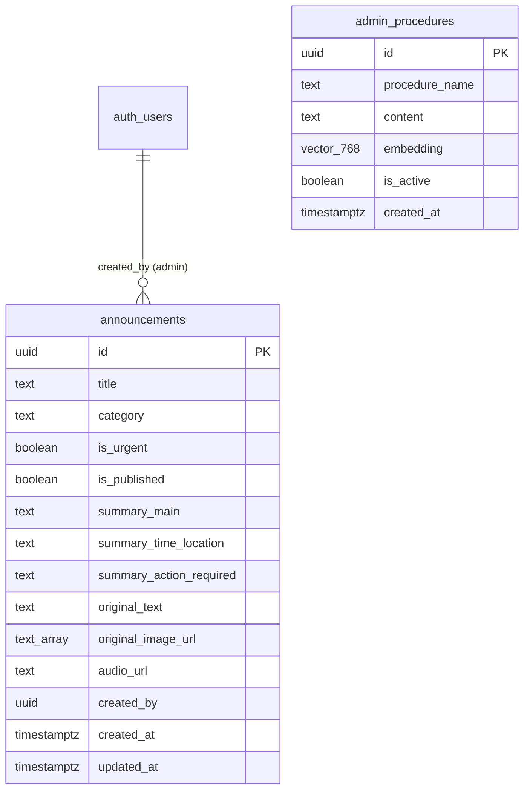

# 07 · Database Schema & ERD

**Product:** Tổ Mình Ơi  
**Engine:** Supabase Postgres + `pgvector`  
**Document status:** Locked (v1)

---

## 1. ERD



Notes:

- No resident user table. No chat message table (stateless chat).
- `announcements.created_by` references `auth.users.id` (seeded admin).
- Embeddings live only on `admin_procedures` (RAG corpus).

---

## 2. Extensions

```sql
create extension if not exists vector;
```

Enable in Supabase Dashboard → Database → Extensions if not already on.

---

## 3. Tables

### 3.1 `announcements`

Bulletin items for residents.

```sql
create table if not exists announcements (
  id uuid primary key default gen_random_uuid(),
  title text not null,
  category text not null default 'Hành chính'
    check (category in ('Hành chính', 'Y tế', 'Môi trường', 'An ninh', 'Sự kiện')),
  is_urgent boolean not null default false,
  is_published boolean not null default false,
  summary_main text not null,
  summary_time_location text,
  summary_action_required text,
  original_text text,
  original_image_url text[],
  audio_url text,
  created_by uuid references auth.users(id),
  created_at timestamptz not null default timezone('utc', now()),
  updated_at timestamptz not null default timezone('utc', now())
);

create index if not exists announcements_published_created_idx
  on announcements (is_published, created_at desc);

create index if not exists announcements_category_idx
  on announcements (category)
  where is_published = true;
```

| Column | Meaning |
|--------|---------|
| `title` | Short headline (AI or admin) |
| `category` | Fixed enum-like list (VN labels) |
| `is_urgent` | Red “Khẩn cấp” badge |
| `is_published` | false = hidden/draft; public API only returns true |
| `summary_main` | 2–3 sentence main summary (TTS reads this first) |
| `summary_time_location` | When & where |
| `summary_action_required` | What residents must prepare/do |
| `original_text` | Raw paste for “Xem nguyên văn” |
| `original_image_url` | Public URLs of scanned notice images (`text[]`, max 5; migration `002_multi_image.sql`) |
| `audio_url` | Pre-generated Edge TTS MP3 (nullable) |
| `created_by` | Admin user id |

Migrations: `001_init.sql` (base) → `002_multi_image.sql` (`original_image_url` text → `text[]`, old single URL wrapped in one-element array). Run in Supabase SQL editor or `supabase db push`.

### 3.2 `admin_procedures`

RAG knowledge base for procedure Q&A.

```sql
create table if not exists admin_procedures (
  id uuid primary key default gen_random_uuid(),
  procedure_name text not null,
  content text not null,
  embedding vector(768),
  is_active boolean not null default true,
  created_at timestamptz not null default timezone('utc', now())
);

create index if not exists admin_procedures_embedding_idx
  on admin_procedures
  using hnsw (embedding vector_cosine_ops)
  where is_active = true and embedding is not null;
```

| Column | Meaning |
|--------|---------|
| `procedure_name` | Display name + search hint (VN) |
| `content` | Full structured text: hồ sơ / nơi nộp / thời gian / lệ phí |
| `embedding` | `gemini-embedding-2` @ 768, cosine |
| `is_active` | Soft disable without delete |

`content` recommended shape (plain text, one procedure per row):

```text
Hồ sơ cần mang: ...
Nơi nộp: Bộ phận Một cửa UBND phường Cẩm Lệ
Thời gian giải quyết: ...
Lệ phí: ...
Ghi chú: ...
```

Chunking: **one procedure = one row** for v1 (procedures are short). If a procedure exceeds ~8k input tokens later, split into thematic chunks with shared `procedure_name` prefix.

---

## 4. RPC — vector search

```sql
create or replace function match_procedures (
  query_embedding vector(768),
  match_threshold float default 0.35,
  match_count int default 4
)
returns table (
  id uuid,
  procedure_name text,
  content text,
  similarity float
)
language sql stable
as $$
  select
    p.id,
    p.procedure_name,
    p.content,
    1 - (p.embedding <=> query_embedding) as similarity
  from admin_procedures p
  where p.is_active = true
    and p.embedding is not null
    and 1 - (p.embedding <=> query_embedding) > match_threshold
  order by p.embedding <=> query_embedding
  limit match_count;
$$;
```

- Similarity metric: cosine via `<=>`.
- Default threshold **0.35**: tune during seed QA. Below → prefer guardrail “not in corpus”.
- `match_count` 4: enough context without blowing prompt size.

---

## 5. Row Level Security

Final state after `001_init.sql`:

```sql
alter table announcements enable row level security;
alter table admin_procedures enable row level security;

-- Public: read published announcements only
create policy "public_read_published_announcements"
  on announcements for select
  using (is_published = true);

-- Admin: full CRUD (authenticated + email matches seeded admin)
create policy "admin_all_announcements"
  on announcements for all
  using (auth.role() = 'authenticated')
  with check (auth.role() = 'authenticated');

-- Public: read active procedures (RAG corpus is public knowledge)
create policy "public_read_procedures"
  on admin_procedures for select
  using (is_active = true);

-- Admin: manage procedures
create policy "admin_all_procedures"
  on admin_procedures for all
  using (auth.role() = 'authenticated')
  with check (auth.role() = 'authenticated');
```

Hardening for production beyond demo:

- Disable public sign-up (Auth settings) — it is the only gate on admin writes in this demo.
- Restrict admin policies to `auth.uid() = created_by` for announcements, or a `profiles.role = 'admin'` check.
- Service role key bypasses RLS — server-only.

---

## 6. Storage buckets

| Bucket | Public | Contents | Path pattern |
|--------|--------|----------|--------------|
| `announcements` | yes | Original notice images | `images/{announcementId}/{timestamp}.jpg` |
| `announcements` | yes | Fallback TTS | `audio/{announcementId}.mp3` |

Create via Dashboard → Storage → New bucket `announcements` → Public **on**.

Upload rules (client admin only, still enforce via Auth):

- Images: `image/jpeg`, `image/png`, `image/webp`, max ~2 MB.
- Audio: `audio/mpeg` written by server (Edge TTS) using service role.

---

## 7. Updated trigger (optional)

```sql
create or replace function set_updated_at()
returns trigger as $$
begin
  new.updated_at = timezone('utc', now());
  return new;
end;
$$ language plpgsql;

drop trigger if exists announcements_updated_at on announcements;
create trigger announcements_updated_at
  before update on announcements
  for each row execute function set_updated_at();
```

---

## 8. Seed data (SAMPLE — verify before live)

> **Status:** SAMPLE content for demo. Research based on common Vietnamese ward-level procedures (hộ tịch, cư trú, BHYT, CCCD…).  
> **Before production / judging handout:** re-check with **Bộ phận Một cửa UBND phường Cẩm Lệ**. Mark final rows `is_active = true` only after confirmation.  
> **Do not invent fees or deadlines in live copy without official source.**

### 8.1 Six sample announcements

| # | title | category | is_urgent | summary_main (excerpt) |
|---|-------|----------|-----------|------------------------|
| 1 | Tiêm chủng mở rộng cho trẻ em tháng 12 | Y tế | true | Trạm Y tế phường tổ chức tiêm chủng mở rộng tại Nhà văn hóa tổ… |
| 2 | Tổng vệ sinh môi trường phòng chống sốt xuất huyết | Môi trường | false | Đợt tổng vệ sinh, phun xịt diệt muỗi tại các tuyến hẻm… |
| 3 | Đăng ký khám sức khỏe nghĩa vụ quân sự | Hành chính | true | Thanh niên trong độ tuổi đăng ký khám tại UBND phường… |
| 4 | Cảnh báo lừa đảo giả mạo ngân hàng | An ninh | true | Nhiều trường hợp nhận tin nhắn “khóa tài khoản” yêu cầu chuyển tiền… |
| 5 | Hội chợ Tết tại Nhà văn hóa phường | Sự kiện | false | Hội chợ Tết với gian hàng đặc sản, biểu diễn nghệ thuật… |
| 6 | Thu gom rác thải điện tử | Môi trường | false | Điểm thu gom pin, bóng đèn, thiết bị điện tử cũ… |

Full text for each (expand during seed script):

```text
[1] title: Tiêm chủng mở rộng cho trẻ em tháng 12
category: Y tế | is_urgent: true
summary_main: Trạm Y tế phường Cẩm Lệ tổ chức tiêm chủng mở rộng cho trẻ em trong độ tuổi. Cha mẹ đưa con đến theo lịch từng tổ dân phố.
summary_time_location: 08:00–11:00, các buổi sáng trong tuần; tại Trạm Y tế phường (số … đường …).
summary_action_required: Mang theo sổ tiêm chủng, giấy khai sinh hoặc CCCD của trẻ; trẻ đang sốt hoặc uống thuốc kháng sinh cần hoãn và báo lại.
original_text: (dán nguyên văn thông báo Trạm Y tế khi có)

[2] title: Tổng vệ sinh môi trường phòng chống dịch sốt xuất huyết
category: Môi trường | is_urgent: false
summary_main: Đợt tổng vệ sinh môi trường, loại bỏ vật đọng nước, diệt lăng quăng bọ gậy trên địa bàn phường.
summary_time_location: Thứ Bảy hằng tuần; điểm tập trung từng tổ dân phố do Tổ trưởng thông báo.
summary_action_required: Dọn dẹp sân thượng, chậu cây, lốp xe cũ; tham gia lao động cùng tổ; mang găng tay nếu có.

[3] title: Đăng ký khám sức khỏe nghĩa vụ quân sự
category: Hành chính | is_urgent: true
summary_main: Nam công dân đủ tuổi thực hiện nghĩa vụ quân sự đăng ký khám sức khỏe tại UBND phường trước đợt khám của quận.
summary_time_location: Trong tháng được phân công; tại Bộ phận Một cửa UBND phường Cẩm Lệ, giờ hành chính.
summary_action_required: Mang CCCD, sổ hộ khẩu hoặc giấy xác nhận cư trú, 2 ảnh 4x6; liên hệ Tổ trưởng nếu chưa nhận giấy mời.

[4] title: Cảnh báo lừa đảo giả mạo ngân hàng
category: An ninh | is_urgent: true
summary_main: Nhiều người dân nhận tin nhắn/Zalo mạo danh ngân hàng yêu cầu cài app hoặc chuyển tiền “xác minh”. Đây là lừa đảo.
summary_time_location: Diễn ra liên tục qua SMS, Zalo, cuộc gọi; không gắn một sự kiện cụ thể.
summary_action_required: Không cài app theo link lạ; không đọc mã OTP; gọi tổng đài in trên thẻ ngân hàng để xác minh; báo công an phường nếu đã chuyển tiền.

[5] title: Hội chợ Tết tại Nhà văn hóa phường
category: Sự kiện | is_urgent: false
summary_main: Hội chợ Tết với gian hàng đặc sản, quà Tết, biểu diễn nghệ thuật chào năm mới.
summary_time_location: (ngày cụ thể do Ban Tổ chức ấn định); Nhà văn hóa phường Cẩm Lệ.
summary_action_required: Đến sớm nếu muốn mua hàng; giữ trẻ nhỏ; không mang vũ khí, vật cấm.

[6] title: Điểm thu gom rác thải điện tử
category: Môi trường | is_urgent: false
summary_main: Phường tiếp nhận pin, bóng đèn huỳnh quang, thiết bị điện tử cũ để xử lý đúng quy định.
summary_time_location: Các buổi chiều thứ Năm hằng tuần; điểm thu gom tại trụ sở UBND phường.
summary_action_required: Mang thiết bị còn nguyên vỏ; không vứt pin vào thùng rác sinh hoạt; hỏi nhân viên nếu chưa chắc phân loại.
```

*(Anti-lừa đảo sample in seed should also exist as canned scam-check inputs in app constants — see `08-API-SPEC.md` / `03-USER-FLOWS.md`, not necessarily as an announcement.)*

### 8.2 Twelve sample procedures

Embed with `gemini-embedding-2` @ 768 after insert. Mark `SAMPLE` until verified.

| # | procedure_name | content outline |
|---|----------------|-----------------|
| 1 | Đăng ký khai sinh | Hồ sơ: tờ khai, giấy chứng sinh, CCCD cha/mẹ; Nơi: Bộ phận Một cửa UBND phường; Thời gian: ngay trong ngày (hồ sơ đủ); Lệ phí: miễn |
| 2 | Đăng ký khai tử | Hồ sơ: tờ khai, giấy báo tử hoặc hồ sơ bệnh viện, CCCD người khai; Nơi: UBND phường; Thời gian: theo quy định hiện hành; Lệ phí: miễn |
| 3 | Cấp bản sao trích lục hộ tịch | Hồ sơ: yêu cầu bằng văn bản/đơn, CCCD; Nơi: UBND phường; Thời gian: nhận ngay hoặc theo hẹn; Lệ phí: theo quy định |
| 4 | Giấy xác nhận tình trạng hôn nhân | Hồ sơ: đơn, CCCD, bản sao hộ tịch liên quan; Nơi: UBND phường (hoặc UBND cấp huyện tùy quy định hiện hành — verify); Lệ phí: miễn/một phần |
| 5 | Đăng ký thường trú | Hồ sơ: tờ khai, giấy tờ chỗ ở hợp pháp; Nhiều nội dung chuyển sang CSDL dân cư / VNeID từ 2023 — ghi chú “khai thác CSDL, không bắt buộc sổ hộ khẩu giấy”; Nơi: UBND phường / CSDL |
| 6 | Đăng ký tạm trú / thông báo lưu trú | Hồ sơ: tờ khai, CCCD chủ nhà, giấy tờ chỗ ở; Nơi: UBND phường hoặc công an cấp xã theo phân định — verify local; Thời gian: ngắn |
| 7 | Cấp thẻ bảo hiểm y tế (đối tượng tự nguyện / hộ gia đình) | Hồ sơ: tờ khai TK1-TS, CCCD, giấy tờ đối tượng ưu đãi nếu có; Nơi: UBND phường hoặc tổ thu BHYT / BHXH quận — verify; Lệ phí: mức đóng theo quy định |
| 8 | Liên thông khai sinh – thường trú – BHYT trẻ dưới 6 tuổi | Hồ sơ: tờ khai khai sinh, giấy chứng sinh, CCCD cha/mẹ, tờ khai BHYT; Nơi: Bộ phận Một cửa UBND phường; Thời gian: rút gọn nếu đủ điều kiện — verify; Lệ phí: miễn lệ phí đăng ký khai sinh |
| 9 | Cấp mới / đổi thẻ CCCD | Nơi chính: Công an cấp huyện/thành phố — phường chỉ hướng dẫn, không cấp; ghi rõ “không nộp tại phường”; điều kiện: đủ 14 tuổi, chưa có CCCD hoặc CCCD hết hạn/sai thông tin |
| 10 | Xác nhận cư trú / thông tin cư trú | Khi CSDL tra được: dùng CCCD/định danh điện tử; khi không tra được: xuất trình CCCD hoặc giấy tờ cư trú theo Nghị định 104; Nơi: UBND phường hướng dẫn/make confirmation per local practice — verify |
| 11 | Ghi chú tạm vắng | Hồ sơ: tờ khai; Nơi: công an địa bàn theo phân định; Thời gian: ngắn |
| 12 | Đề nghị hưởng trợ cấp xã hội / bảo trợ xã hội (hướng dẫn) | Hồ sơ theo từng nhóm đối tượng; Nơi: UBND phường tiếp nhận, Phòng LĐTB&XH xét; Lệ phí: miễn; ghi chú cần xác nhận hoàn cảnh |

Full `content` strings for seed (Vietnamese, structured) live in `scripts/seed-procedures.ts` — structure per procedure:

```ts
{
  procedure_name: 'Đăng ký khai sinh',
  content: `Hồ sơ cần mang: Tờ khai đăng ký khai sinh (mẫu); Giấy chứng sinh; CCCD/CMND của cha hoặc mẹ; Giấy chứng nhận kết hôn của cha mẹ (nếu có).
Nơi nộp: Bộ phận tiếp nhận và trả kết quả – UBND phường Cẩm Lệ (Thứ Hai đến Thứ Sáu, sáng thứ Bảy theo giờ hành chính).
Thời gian giải quyết: Đăng ký ngay trong ngày nếu hồ sơ đủ và nộp trước 15 giờ; trường hợp khác vào ngày làm việc tiếp theo (tham khảo quy định hiện hành).
Lệ phí: Miễn lệ phí đăng ký khai sinh.
Ghi chú: Một số dịch vụ công liên thông đã thực hiện trực tuyến qua Cổng dịch vụ công / VNeID – nên hỏi trước khi đến.`
}
```

**Embedding seed procedure (outline):**

1. Insert rows with `embedding = null`.
2. For each row: embed `procedure_name + '\n' + content` → `gemini-embedding-2`, dim 768.
3. `update admin_procedures set embedding = $1 where id = $2`.
4. Smoke-test: 5 sample questions → `match_procedures` → confirm top hit sensible.

---

## 9. Environment mapping

| Env var | Maps to |
|---------|---------|
| `NEXT_PUBLIC_SUPABASE_URL` | Project URL |
| `NEXT_PUBLIC_SUPABASE_PUBLISHABLE_KEY` | Browser queries (RLS applies) — `sb_publishable_…` |
| `SUPABASE_SECRET_KEY` | Seed, Edge TTS upload, admin bootstrap — `sb_secret_…` (server only) |
| `GEMINI_EMBEDDING_MODEL` | `gemini-embedding-2` |
| `GEMINI_EMBEDDING_DIM` | `768` — must equal `vector(768)` |

---

## 10. Migration / setup order

1. Create Supabase project.
2. Enable `vector` extension.
3. Run §3 DDL, §4 RPC, §5 RLS, §7 trigger.
4. Create Storage bucket `announcements` (public).
5. Disable public sign-up (Auth settings).
6. Create seeded admin user (Auth → Users).
7. Run seed: announcements + procedures + embeddings + optional TTS MP3s.
8. Verify RLS: anon client cannot `select` unpublished rows; cannot `insert`; a second non-admin user cannot `insert`.

---

## Related documents

- Stack & models → `05-TECH-STACK.md`
- API shapes over these tables → `08-API-SPEC.md`
- RAG/guardrail design → `06-TDD.md`
